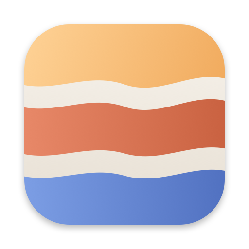

<p align="center"></p>

# StrataBar

A macOS menu bar app for [Strata](https://github.com/Niko1221/Strata), in the style of Ollama's: start, pause and
stop the Strata server, and chat with it in a native window, without keeping a terminal open.

This is an unofficial companion app. It is not part of Strata and is not maintained by its authors. It does not
change Strata: it starts Strata's own server with the run config Strata's setup wrote, and uses the server's
existing HTTP API.

## What it does

- **Start Service / Stop Service** run the Strata server as a launchd job. The server belongs to launchd, not to this
  app or a terminal: quitting StrataBar or closing a terminal leaves the model as it is.
- **Pause / Resume** unload and load the model through the server's `POST /unload` and `POST /load`. The memory
  is freed while paused, and the HTTP server stays up. Any API request while paused loads the model again (the
  server does that by itself). **Stop Service** is the hard off.
- **Open Chat Window** shows Strata's own web app in a native window. The API key is taken from the run config, so
  nothing needs to be typed. The window handles image uploads, downloads (into `~/Downloads`) and links (opened in
  the default browser).
- **Open API Monitor** shows Strata's `/api-monitor` page in its own window: the last 100 requests that apps sent
  to the server, with their prompts and answers, kept in the server's memory only. It needs `"api_monitor": true`
  in the run config; without it the item is greyed out.
- **Copy API URL** copies `http://127.0.0.1:<port>/v1` for other apps.
- **Show Log** opens the server's log in Console.
- The menu bar icon shows the state: all three layers filled when the model is loaded, the top layer hollow when it
  is paused, the layers filling up while it starts or loads, and the icon dimmed when the service is stopped.

Nothing starts at login: the service starts only when you choose **Start Service**.

## What you need

- An Apple Silicon Mac with macOS 15 or newer, as Strata on a Mac needs ([Strata's docs/MAC.md](https://github.com/Niko1221/Strata/blob/main/docs/MAC.md)).
- Strata installed with its `./setup.sh`. StrataBar looks for it in `~/Strata`; a different folder can be chosen
  in the menu.
- To build from source: the Command Line Tools (`xcode-select --install`), for `swiftc`. Strata's setup needs them
  too.

## Download

**[Download StrataBar for macOS](https://github.com/fengzhyuan/Strata-UI/releases/latest/download/StrataBar.zip)**
(Apple Silicon, macOS 15 or newer; signed with a Developer ID and notarized by Apple). Unzip it, move
`StrataBar.app` into Applications and open it. macOS asks once whether to open an app downloaded from the internet.

Older versions and their notes are on the [releases page](https://github.com/fengzhyuan/Strata-UI/releases).

## Build from source

```sh
git clone https://github.com/fengzhyuan/Strata-UI.git
cd Strata-UI
./build.sh                       # builds ~/Applications/StrataBar.app
open ~/Applications/StrataBar.app
```

`./build.sh /Applications` installs into another folder. The app is signed ad hoc, which is enough for a build
made on the same Mac. Run `./build.sh` again after pulling changes: it replaces the app, and a running model is
not affected.

## Release builds

`./release.sh` builds the app for a GitHub release: signed with a Developer ID, notarized by Apple and stapled, so
a downloaded copy opens without a Gatekeeper prompt. It writes `build/release/StrataBar.zip`, the asset to upload
to a release tagged `v<version>` (the version in `Info.plist`); the name stays the same in every release, so the
download link above always gets the latest. It needs a Developer ID Application certificate and a `notarytool`
keychain profile; the top of the script says how to set them up.

## How it works

| | |
|---|---|
| Run config | `strata-<model>.json` in the Strata folder, as setup writes it. With several, a **Model** submenu picks one (while the service is stopped). The port, host and API key are read from it on every use. |
| Server command | The one setup writes into `run-<model>.sh`: `.venv/bin/python serve/server.py --engine strata --config strata-<model>.json --port <port>`, without `--open`. |
| launchd job | `io.github.fengzhyuan.StrataBar.server`, written to `~/Library/Application Support/StrataBar/server.plist` on every start. It restarts the server after a crash, not after a stop. It is not in `~/Library/LaunchAgents`, so it does not start at login. |
| Log | `~/Library/Logs/StrataBar/server.log` |
| Settings | The Strata folder and the chosen model, in `defaults read io.github.fengzhyuan.StrataBar`. |

StrataBar never stores the API key. It reads it from the run config for each request, and the chat window puts it
into the web app's own storage (`localStorage["strata.apikey"]`), as typing it into the web app would.

A server started some other way (for example `./run-<model>.sh` in a terminal) is shown with a note, and **Pause /
Resume** work for it. **Stop Service** stops only the server StrataBar started.

## Uninstall

```sh
launchctl bootout gui/$(id -u)/io.github.fengzhyuan.StrataBar.server   # if the service is running
rm -rf ~/Applications/StrataBar.app "$HOME/Library/Application Support/StrataBar" ~/Library/Logs/StrataBar
defaults delete io.github.fengzhyuan.StrataBar
```

## Tested on

An Apple M3 Ultra with 96 GB, macOS 27.0, Swift 6.4, with Strata's IQ3_S pack. Other Macs and packs are untested.

## License

MIT, as Strata. See [LICENSE](LICENSE).
